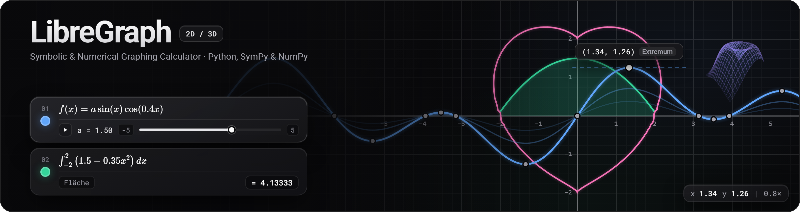
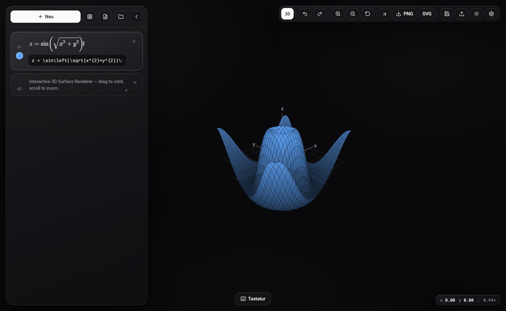
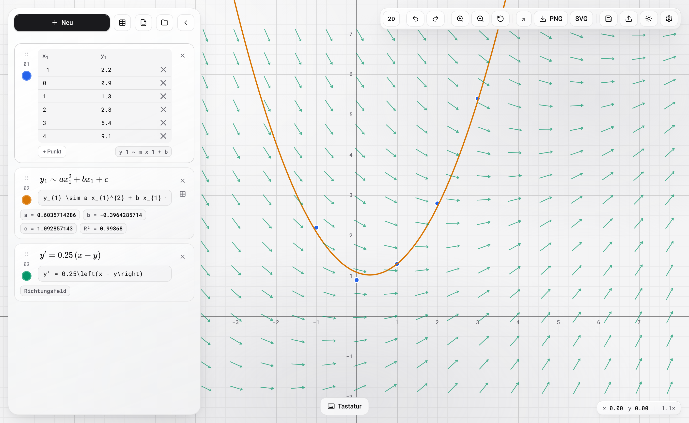
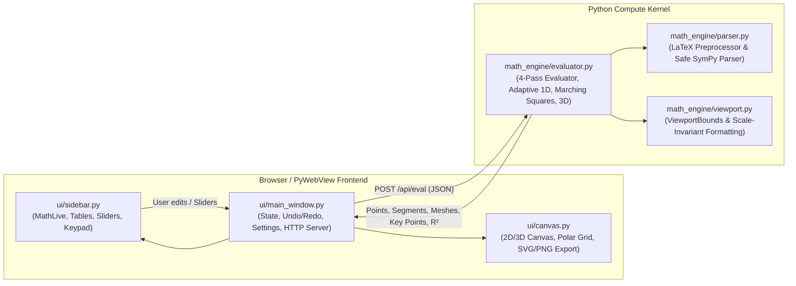

<div align="center">



<br />
<br />

[](https://www.python.org/)
[](https://www.sympy.org/)
[](https://numpy.org/)
[](https://pywebview.flowrl.com/)
[](#license)
[](https://github.com/Lukas-eft/LibreGraph/pulls)

**An interactive 2D and 3D graphing calculator built with Python, SymPy, and NumPy.**

[Key Features](#-key-features) •
[Visual Showcase](#-visual-showcase) •
[Quick Start](#-quick-start--setup-guide) •
[Math Syntax](#-expression-syntax--cheat-sheet) •
[Architecture](#-architecture-overview) •
[Controls](#-keyboard-shortcuts--controls)

<br />


<sub><em>2D Dark Mode: Live MathLive LaTeX input, parameter sliders, shaded definite integrals, key point detection, and vectorized Marching Squares implicit plotting.</em></sub>

</div>

---

## ✨ Key Features

### 📈 2D Graphing Engine
- **Explicit & Inverse Functions:** Plot $y = f(x)$, $x = g(y)$, piecewise functions, and custom named functions $f(x), g(a)$ with full nested composition.
- **Parametric & Polar Curves:** Evaluate $(x(t), y(t))$ and $r = f(\theta)$ with customizable domain bounds such as $\{0 \le t \le \pi\}$ or $\{0 \le \theta \le \frac{\pi}{2}\}$.
- **Implicit Curves & Inequalities:** Vectorized **Marching Squares** solver for arbitrary $F(x, y) = 0$ equations, strict/non-strict inequalities, chained compound inequalities ($x^2 \le y \le 2x + 1$), and exact axis-aligned box/strip regions.
- **Adaptive Multi-Scale Sampling:** Automatically refines steep gradients, singularities, NaN boundaries, and vertical asymptotes across scales from $10^{-250}$ up to $10^{12}$.

### 🧊 3D Surface & Mesh Engine
- **Explicit 3D Heightfields:** Render $z = f(x, y)$ surfaces with height-shaded depth-sorted quads and interactive camera orbit/zoom.
- **Parametric 3D Surfaces & Space Curves:** Visualize $(x(u, v), y(u, v), z(u, v))$ meshes (e.g., tori and spheres), 3D parametric curves $(x(t), y(t), z(t))$, and 3D points.
- **Implicit 3D Surfaces:** Render $F(x, y, z) = 0$ level sets using a vectorized 3D **Surface Nets** mesher with automatic axis-extent probing.

### ∫ Symbolic & Numerical Calculus
- **Derivatives:** Compute $\frac{d}{dx}(\dots)$ and higher-order prime notation $f'(x), f''(x), f'''(x)$ symbolically via SymPy with automatic central finite-difference fallback for non-elementary expressions.
- **Definite & Indefinite Integrals:** Evaluate $\int_a^b f(x)\,dx$ symbolically (or via fine-grid trapezoidal quadrature fallback) with shaded area visualization and dashed boundary markers.
- **Series & ODEs:** Expand finite sums $\sum_{n=a}^{b}$ and products $\prod_{n=a}^{b}$ (up to 120 terms), and plot 1st-order differential equation slope fields ($y' = f(x, y)$ or $\frac{dy}{dx} = f(x, y)$).

### 📊 Data Tables, Lists & Regressions
- **Interactive Data Tables:** Add $(x_1, y_1)$ tables manually or paste multi-row **CSV / TSV** data directly from spreadsheets.
- **Least-Squares Regressions:** Fit linear and polynomial models such as $y_1 \sim m x_1 + b$ or $y_1 \sim a x_1^2 + b x_1 + c$ with live fitted parameter badges and $R^2$ goodness-of-fit scores.
- **Lists & Curve Families:** Define ranges (`a = [1...5]`, `a = [0, 0.5, ..., 3]`) or inline lists (`[1, 2, 3]`) to generate curve families across functions, polar plots, inequalities, and 3D surfaces.

### 🎯 Curve Analysis & Clean UI
- **Key Points & Live Tangent Tracing:** Automatically detects roots, local extrema, $y$-intercepts, and curve-to-curve intersections; hover any curve for live coordinates and tangent slope $f'(x)$.
- **WYSIWYG Math Input:** Live LaTeX editing via **MathLive** and **KaTeX**, paired with an optional raw LaTeX input bar and a tabbed on-screen math keypad (`Basic`, `Functions`, `Symbols`).
- **Workspace Tools:** Animated auto-sliders and explicit parameter sliders, collapsible folders and notes, 60-step Undo/Redo history, `localStorage` autosave, `.json` project save/load, Dark/Light themes, $\pi$-axis ticks, polar grid overlay, and **Vector SVG** + **HiDPI PNG** export.

---

## 🖼️ Visual Showcase

<table>
  <tr>
    <td width="50%" align="center">
      
      <br />
      <strong>Interactive 3D Surface Mode</strong><br />
      <sub>Depth-sorted 3D heightfield <code>z = sin(sqrt(x^2 + y^2))</code> with mouse orbit, zoom, and live theme adaptation.</sub>
    </td>
    <td width="50%" align="center">
      
      <br />
      <strong>Light Mode: Regressions &amp; ODE Slope Fields</strong><br />
      <sub>Data table paired with quadratic regression <code>y_1 ~ a x_1^2 + b x_1 + c</code> (R² = 0.99868) and slope field <code>y' = 0.25(x - y)</code>.</sub>
    </td>
  </tr>
</table>

---

## 🚀 Quick Start & Setup Guide

### Prerequisites
- **Python 3.10+** (tested with Python 3.11)
- **pip** (Python package manager)
- Internet access on first load for CDN assets (**MathLive**, **KaTeX**, and **Roboto / Roboto Mono** fonts; raw input fallback works automatically if offline)

### 1. Clone the Repository
```bash
git clone https://github.com/Lukas-eft/LibreGraph.git
cd LibreGraph
```

### 2. Create & Activate a Virtual Environment

<details open>
<summary><strong>Windows (PowerShell)</strong></summary>

```powershell
python -m venv .venv
.\.venv\Scripts\Activate.ps1
```

</details>

<details>
<summary><strong>macOS / Linux (bash / zsh)</strong></summary>

```bash
python3 -m venv .venv
source .venv/bin/activate
```

</details>

### 3. Install Dependencies

```bash
pip install -r requirements.txt
```

This installs the core math engine dependencies (`numpy>=1.24` and `sympy>=1.12`).

#### Optional: Native Desktop Window Mode (`pywebview`)
By default, LibreGraph automatically opens in your default web browser. If you prefer a standalone native desktop window with OS Save/Open dialogs:

```bash
pip install pywebview>=5.0
```

### 4. Launch LibreGraph

```bash
python main.py
```

- **With `pywebview` installed:** Launches a `1360×860` native desktop window (`Graphing Calculator`).
- **Without `pywebview`:** Starts the local `ThreadingHTTPServer` on `127.0.0.1` (random free port) and opens the app directly in your default browser. Press `Ctrl+C` in the terminal to stop the server.

---

## 🧮 Expression Syntax & Cheat Sheet

| Category | Example Input | Description |
| :--- | :--- | :--- |
| **Explicit 2D Curve** | `y = \sin(x) + 0.5x` | Standard 2D plot with automatic roots, extrema, and intersections |
| **Inverse Relation** | `x = y^2 - 2` | Explicit $x(y)$ curve plotted along the vertical axis |
| **Named Function & Derivative** | `f(x) = x^3 - 3x`, `f'(x)` | Defines reusable function $f$ and plots its 1st/2nd/3rd derivative |
| **Differential Operator** | `\frac{d}{dx}(e^{-x^2})` | Symbolic differentiation with live curve plotting |
| **Definite Integral** | `\int_{-2}^{2} (1.5 - 0.35x^2) dx` | Computes integral value and shades area under the curve |
| **Sum / Product** | `\sum_{n=1}^{8} \frac{\sin(nx)}{n}` | Evaluates finite sums and products (up to 120 terms) |
| **Piecewise Function** | `y = \{x < 0: -x, x \ge 0: x^2\}` | Multi-branch conditional expressions |
| **Domain Restriction** | `y = \sin(x) \{-\pi \le x \le \pi\}` | Restricts any 2D, parametric, polar, ODE, or 3D plot |
| **Parametric 2D Curve** | `(\cos(t), \sin(t)) \{0 \le t \le \pi\}` | Parametric curve over custom or default $t \in [0, 2\pi]$ |
| **Polar Equation** | `r = 2\cos(3\theta)` | Polar plot over $\theta \in [0, 4\pi]$ (supports $\theta$ bounds) |
| **Implicit 2D Curve** | `(x^2 + y^2 - 4)^3 - x^2 y^3 = 0` | Implicit level set computed via vectorized Marching Squares |
| **Inequalities** | `x^2 \le y \le 2x + 1 \{x \ge 0\}` | Shaded region with solid ($\le, \ge$) or dashed ($<, >$) boundaries |
| **ODE Slope Field** | `y' = 0.25(x - y)` | 1st-order differential equation direction field (`y'` or `dy/dx`) |
| **3D Surface** | `z = \sin(\sqrt{x^2 + y^2})` | Explicit 3D heightfield rendered in 3D mode |
| **Parametric 3D Surface** | `((3+\cos(v))\cos(u), (3+\cos(v))\sin(u), \sin(v))` | Parametric torus/surface over $(u, v) \in [0, 2\pi]^2$ |
| **Implicit 3D Surface** | `x^2 + y^2 + z^2 = 9` | 3D implicit level set rendered via Surface Nets |
| **Lists & Curve Families** | `a = [1, 1.5, ..., 4]`, `y = a\sin(x)` | Generates a family of curves across list values |
| **Regression** | `y_1 \sim a x_1^2 + b x_1 + c` | Fits linear-in-parameters models to table $1$ and displays $R^2$ |

---

## 🏗️ Architecture Overview

LibreGraph decouples a pure-Python symbolic/numerical compute backend from a zero-build HTML5 Canvas & MathLive frontend served over a local `ThreadingHTTPServer`:



### Project Structure

```text
LibreGraph/
├── main.py                  # Application entry point (pywebview / browser launcher)
├── requirements.txt         # Core Python dependencies (numpy, sympy)
├── assets/                  # README visual assets (banner & live screenshots)
├── math_engine/
│   ├── __init__.py
│   ├── parser.py            # LaTeX preprocessor, domain/piecewise/list/ODE/regression parser
│   ├── evaluator.py         # 4-pass evaluator, adaptive sampling, Marching Squares, 3D nets
│   └── viewport.py          # Scale-invariant coordinate clamping & float formatting
├── ui/
│   ├── __init__.py
│   ├── main_window.py       # ThreadingHTTPServer, /api/eval & /api/export, global state & shortcuts
│   ├── canvas.py            # 2D/3D Canvas renderer, polar grid, tangent tracing, SVG/PNG export
│   └── sidebar.py           # MathLive expression cards, style popover, folders, tables, keypad
└── utils/
    ├── __init__.py
    └── config.py            # AppConfig, ViewportConfig, SamplingConfig, Dark/Light palettes
```

---

## ⌨️ Keyboard Shortcuts & Controls

| Context | Input / Shortcut | Action |
| :--- | :--- | :--- |
| **Global** | `Ctrl + Z` / `Cmd + Z` | Undo last project change (up to 60 history states) |
| **Global** | `Ctrl + Y` or `Ctrl + Shift + Z` | Redo undone change |
| **Global** | `Esc` | Close open settings popover |
| **Expression Editor** | `Enter` | Insert a new expression card below |
| **2D Canvas** | Drag | Pan coordinate viewport |
| **2D Canvas** | Scroll Wheel | Zoom centered at cursor ($10^{-250}$ to $10^{12}$ scale) |
| **2D Canvas** | Hover Curve | Display trace coordinates & tangent line with slope $f'(x)$ |
| **2D Canvas** | Click Key Point | Pin / unpin root, extremum, $y$-intercept, or intersection label |
| **3D Canvas** | Drag / Scroll Wheel | Orbit yaw/pitch camera / zoom 3D viewport |
| **Sidebar Gutter** | Click / Right-Click Color Dot | Open style popover (color, dash, width, opacity) / quick-toggle visibility |
| **Sidebar Gutter** | Drag Grip Handle | Reorder expressions, folders (with children), tables, and notes |
| **Data Table** | `Ctrl + V` / Paste | Bulk-import CSV, TSV, or semicolon-delimited $(x, y)$ rows |

---

## ⚙️ Configuration

All window, viewport, sampling density, and theme palette defaults are centralized in [`utils/config.py`](utils/config.py) (`AppConfig`, `ViewportConfig`, `SamplingConfig`, `PALETTE_DARK`, `PALETTE_LIGHT`, `DEFAULT_SETTINGS`).

---

## License

This project is released under the [MIT License](https://opensource.org/licenses/MIT).
